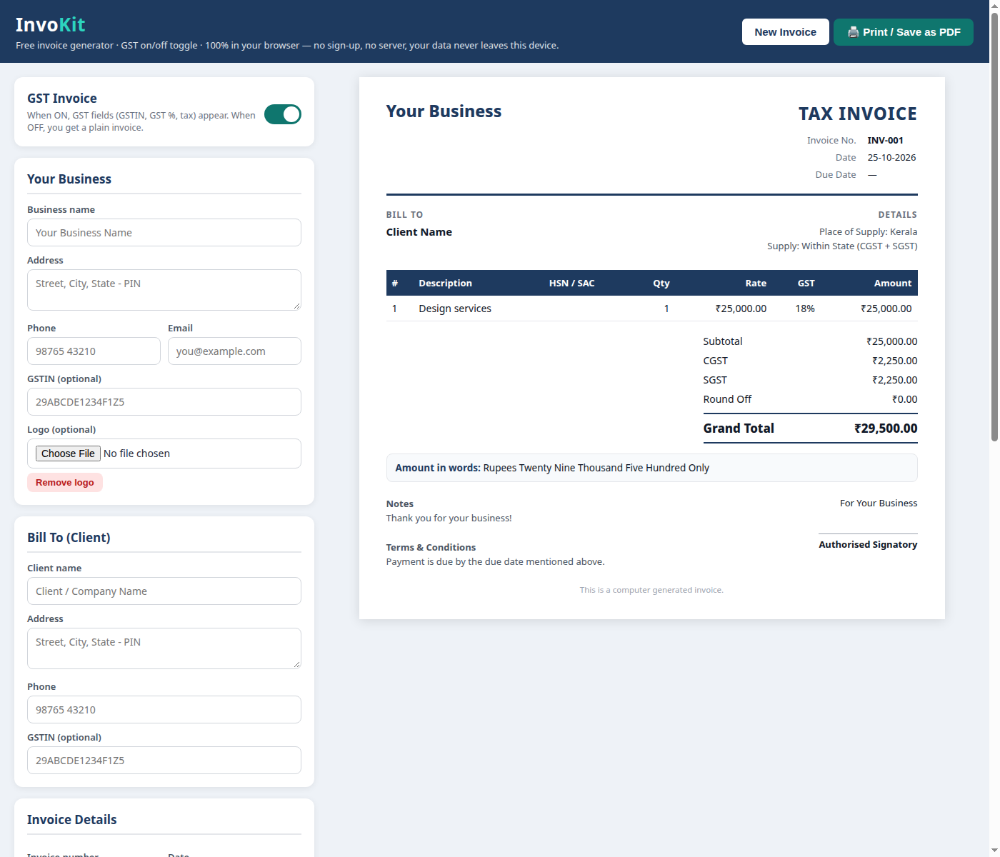

# 🧾 InvoKit

Free invoice generator with optional GST — 100% in your browser. No sign-up, no server, your data never leaves your device.

## 🚀 Try it live

**[https://nuvishh.github.io/InvoKit/](https://nuvishh.github.io/InvoKit/)**

## ✨ Features

- **GST toggle** — ON: TAX INVOICE with GSTIN, GST %, HSN/SAC, CGST/SGST/IGST. OFF: plain invoice, no tax.
- **Live A4 preview** — see the invoice as you type.
- **Indian totals** — round-off, amount in words (lakh / crore system), ₹ formatting.
- **Business + client details** — name, address, phone, email, GSTIN, logo upload.
- **Items table** — description, HSN/SAC, quantity, rate, GST %.
- **Print / Save as PDF** — clean A4 output via the browser print dialog.
- **Auto-saved draft** — your invoice is saved in the browser (localStorage). Nothing is uploaded anywhere.
- **Export / Import** — download your invoice data as a JSON file and restore it on any device or browser — no re-typing.
- **Mobile friendly** — the editor stacks on phones; the invoice still prints full A4.

## 🧾 How to use

1. Open the [live site](https://nuvishh.github.io/InvoKit/).
2. Fill in your business and client details.
3. Add items. Turn the **GST Invoice** toggle ON for GST invoices, OFF for plain ones.
4. Click **Print / Save as PDF** (or press Ctrl+P) and choose "Save as PDF".
5. **New Invoice** clears the items and bumps the invoice number (INV-001 → INV-002, …).

## 🔒 Privacy

InvoKit runs fully client-side in a single `index.html`. There is no backend, no tracking, and no data leaves your device. The draft lives only in your browser's localStorage.

## 🛠️ Run locally

Just open `index.html` in any browser — no build step, no dependencies.

---

Made with ♥ by [nuvish](https://nuvishh.github.io/)
